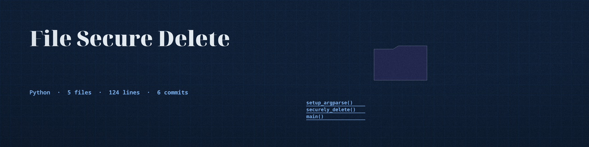

# file-secure-delete

## Project Description

This tool securely deletes files by overwriting them multiple times, preventing data recovery. It focuses on file operations and analysis.

## Installation

```
pip install file-secure-delete
```

## Usage

```
usage: main.py [-h] [--passes PASSES] file_path

Securely delete files by overwriting them multiple times before deletion.

positional arguments:
  file_path              Path to the file you want to securely delete.

options:
  -h, --help             show this help message and exit
  --passes PASSES        Number of overwriting passes to perform (default: 3)
```

## Examples

### Delete a single file securely

```
python main.py myfile.txt
```

### Delete a file with 5 overwriting passes

```
python main.py --passes 5 myfile.txt
```

## Security Warnings

This tool is intended to securely delete files, but it is not foolproof. Deleted data may still be recoverable using advanced techniques. Use it at your own discretion.

## License

This tool is licensed under the GNU General Public License v3.0 to CY83R-3X71NC710N.